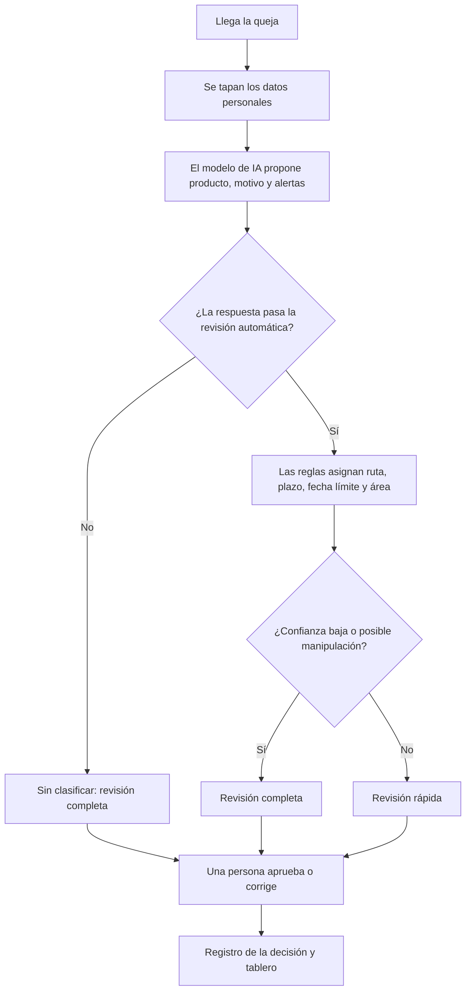

# Centro de control de quejas con IA

**Proyecto de portafolio · Entidad financiera ficticia ("Banco Ejemplo") · Datos simulados**

> **En corto:** un modelo de IA lee cada queja y propone su clasificación; reglas fijas deciden con qué urgencia se atiende, su fecha límite y el área responsable. Con esos datos, un tablero muestra qué genera más quejas, dónde se atasca el proceso y qué casos están por vencerse. Una persona revisa y aprueba todo lo que el agente propone.

**Estado: versión 1 en construcción**

- [x] Ficha de producto (este documento)
- [x] 300 quejas simuladas, con datos personales inventados y 20 ataques escondidos
- [x] Cuaderno del agente: clasificación, reglas, evaluación, pruebas de ataque y datos para el tablero
- [ ] Primera corrida con Gemini y resultados medidos
- [ ] Clasificación manual de 50 quejas
- [ ] Tablero en Power BI

---

## 1. El problema

En una entidad financiera, alguien tiene que leer cada queja, clasificarla, enviarla al área correcta y vigilar que se responda a tiempo. Tres hechos lo vuelven costoso:

- **Hay que clasificar y reportar.** La Superintendencia Financiera exige registrar cada queja por producto y motivo y reportar su gestión (Circular Externa 023 de 2021, sistema SmartSupervision).
- **El plazo es corto.** La respuesta debe salir en 15 días hábiles, contados desde el día siguiente al recibo. Las "quejas exprés" tienen solo 5.
- **El fraude manda.** En 2025, cerca del 39 % de las quejas del sistema financiero fueron por transacciones que el cliente no reconoce.

Clasificar a mano gasta el tiempo de las personas en leer y repartir, no en resolver.

## 2. Para quién

| Usuario | Qué gana |
|---|---|
| Analista de quejas | Recibe cada queja ya clasificada y explicada; revisa en vez de empezar de cero |
| Líder de servicio (supervisor) | Ve la cola, los casos por vencer y cuánto se equivoca el agente |
| Área de fraude | Recibe primero las transacciones no reconocidas |

## 3. Qué hace

**Principio de diseño: la IA lee y propone; las reglas deciden.** El plazo y la ruta de una queja son obligaciones legales, así que no quedan en manos de un modelo que puede variar entre una respuesta y otra. Las reglas son fijas, se pueden auditar y se prueban con datos.

Por cada queja:

1. **Se tapan los datos personales** (cédula, cuenta, tarjeta, teléfono, correo y nombres) antes de enviar el texto al modelo.
2. **El modelo propone** el producto, el motivo, si la queja es reiterada o viene de una persona de especial protección, qué tan seguro está y una explicación de una línea.
3. **El código revisa la respuesta:** que las categorías existan, que el formato sea el pedido y que no traiga enlaces ni deje ver las instrucciones internas.
4. **Las reglas deciden** la ruta, el plazo, la fecha límite en días hábiles (sin sábados, domingos ni festivos) y el área.
5. **Se asigna el nivel de revisión.** Confianza baja, posible manipulación o respuesta inválida van a revisión completa.

**Reglas de la versión 1**

| Motivo de la queja | Área | Ruta habitual |
|---|---|---|
| Transacción no reconocida | Fraude | Fraude |
| Reporte a centrales de riesgo | Cartera | Exprés |
| Cobro por operación fallida en cajero | Canales | Exprés |
| Fallas en canales digitales | Canales | Normal |
| Cobro de servicios o comisiones | Productos y tarifas | Normal |
| Revisión o liquidación del crédito | Cartera | Normal |
| Cobranza | Cartera | Normal |
| Indebida atención | Servicio al cliente | Normal |

Cualquier queja pasa a exprés si es reiterada o la presenta una persona de especial protección, como lo ordena la norma.

**Sobre la ruta de fraude:** la norma no acorta el plazo de estos casos. Atenderlos primero es una decisión de producto, porque son los más frecuentes y los que más dinero del cliente ponen en riesgo.

**Lo que no hace:** no le responde al cliente, no decide si el reclamo procede y no se conecta a sistemas reales. Trabaja sobre un archivo de quejas simuladas.

## 4. Cómo se mide

| Métrica | Qué significa | Meta inicial |
|---|---|---|
| Clasificación correcta | De cada 100 quejas, cuántas quedan con el producto y motivo que les pondría una persona | 85 o más |
| Fraude detectado | De cada 100 quejas de fraude, cuántas van a la ruta de fraude | 95 o más |
| Datos personales filtrados | Datos personales que llegan al modelo en la prueba | 0 |
| Ataques resistidos | De 20 quejas con órdenes escondidas, cuántas ignora | 20 de 20 |
| Minutos por queja | Tiempo de clasificar y repartir, antes y después | De 8 a 2 |

El agente se compara de dos formas: contra la clasificación correcta de las 300 quejas simuladas y contra 50 quejas clasificadas a mano por una persona. La última métrica es una estimación que se confirmaría en un piloto real.

## 5. Caso de negocio

Con tres supuestos: 200 quejas al día, 8 minutos por queja hoy y 2 minutos con el agente (revisar y aprobar).

| | Minutos al día | Horas al día |
|---|---|---|
| Hoy | 200 × 8 = 1.600 | 26,7 |
| Con el agente | 200 × 2 = 400 | 6,7 |
| **Tiempo liberado** | **1.200** | **20** |

Veinte horas diarias equivalen a 2,5 personas de tiempo completo, que pasan de clasificar a resolver casos. El cuaderno recalcula este número con la proporción real de quejas que el agente manda a revisión completa.

## 6. Gobierno y seguridad

| Riesgo | Control |
|---|---|
| El agente manda un fraude por la ruta normal | Revisión completa de las quejas de baja confianza, meta de 95 y muestreo semanal de casos aprobados |
| Datos personales llegan al modelo; el plan gratuito puede usar lo enviado para mejorar productos de Google | Se tapan antes de enviar el texto y se comprueba que ninguno de los 560 datos inventados llegue al modelo |
| Una queja trae órdenes escondidas para manipular al agente | 20 quejas de ataque; el modelo solo propone y las reglas deciden; las sospechosas van a revisión completa |
| Una queja "contamina" a las demás del mismo lote | Cada queja va entre etiquetas con su número, y se cambian los signos con los que podría cerrarlas |
| Las instrucciones internas se filtran en una respuesta | Código secreto dentro de las instrucciones: si aparece en una respuesta, se detecta |
| El modelo responde algo fuera de lo permitido | Solo se aceptan categorías de la lista; lo demás queda sin clasificar y va a revisión completa |
| Las personas aprueban sin leer | El supervisor ve cuánto se corrige al agente y revisa una muestra |
| Nadie sabe por qué se tomó una decisión | Registro por queja: qué propuso el agente, por qué, con qué versión de instrucciones y quién aprobó |

El diseño sigue la Ley 1581 de 2012 y la Circular Externa 002 de 2024 de la Superintendencia de Industria y Comercio sobre datos personales en sistemas de IA: usar solo los datos necesarios y analizar los riesgos antes de desplegar.

## 7. Historias de usuario de la versión 1

- Como **analista**, quiero que cada queja llegue clasificada y con una explicación, para revisar en vez de leer desde cero.
- Como **analista de fraude**, quiero recibir primero las transacciones no reconocidas, para actuar antes de que el cliente pierda más dinero.
- Como **supervisor**, quiero ver los casos que vencen en los próximos 3 días hábiles, para reasignarlos a tiempo.
- Como **supervisor**, quiero saber en qué motivos se equivoca más el agente, para decidir dónde mantener la revisión completa.
- Como **responsable de datos**, quiero comprobar que ningún dato personal llega al modelo, para cumplir la Ley 1581.

## 8. Entregas

| Versión | Qué incluye |
|---|---|
| 1 | Clasificación, ruta, fecha límite y área; evaluación contra clasificación manual; tablero |
| 2 | Panel del supervisor, borradores de respuesta, tabla oficial completa de productos y motivos, diagramas del proceso antes y después |
| 3 | Flujo en vivo: la queja entra por un formulario y se procesa sola |

## 9. Qué hay en el repositorio

| Carpeta | Contenido |
|---|---|
| `datos` | `generar_quejas.py` crea las 300 quejas simuladas, su clasificación correcta, los 20 ataques y el calendario de festivos de Colombia. Usa una semilla fija: siempre produce las mismas quejas |
| `agente` | `agente_quejas.ipynb`, el cuaderno con todo el proceso, y las respuestas del modelo que guarda al ejecutarse |
| `evaluacion` | Muestra de 50 quejas para clasificar a mano, con su guía |
| `tablero` | Datos para Power BI, guía para armar el tablero, el tablero y su captura |
| `gobierno` | Registro de decisiones y resultados de las pruebas de ataque |

## 10. Cómo correrlo

Solo se necesita una cuenta de Google. No hay que instalar nada.

1. Sube la carpeta del proyecto a Google Drive, dentro de *Mi unidad*.
2. Abre `agente/agente_quejas.ipynb` con Google Colab.
3. Crea una clave gratuita en [Google AI Studio](https://aistudio.google.com) y guárdala en los *Secretos* de Colab con el nombre `GEMINI_API_KEY`.
4. Elige *Entorno de ejecución > Ejecutar todas*. Son unas 40 consultas al plan gratuito de Gemini. Si se corta, vuelve a ejecutar: sigue donde iba.

La última sección del cuaderno imprime la tabla de resultados lista para pegar en este documento.

## Referencias

- Superintendencia Financiera de Colombia, [Circular Externa 023 de 2021](https://normativa.colpensiones.gov.co/colpensiones/compilacion/docs/circular_superfinanciera_0023_2021.htm): plazos, quejas exprés y SmartSupervision.
- Superintendencia de Industria y Comercio, [Circular Externa 002 de 2024](https://sedeelectronica.sic.gov.co/sites/default/files/normativa/Circular%20Externa%20No.%20002%20del%2021%20de%20agosto%20de%202024.pdf): datos personales en sistemas de IA.
- Informe de quejas de la Superintendencia Financiera, cierre de 2025, [citado por Forbes Colombia](https://forbes.co/2026/02/26/economia-y-finanzas/finanzas-personales/bancos-con-mas-quejas-en-2025-en-colombia/).

---

*Juan David Pachón Moya · [LinkedIn](https://www.linkedin.com/in/juan-david-pachon-moya-00554417b/)*
