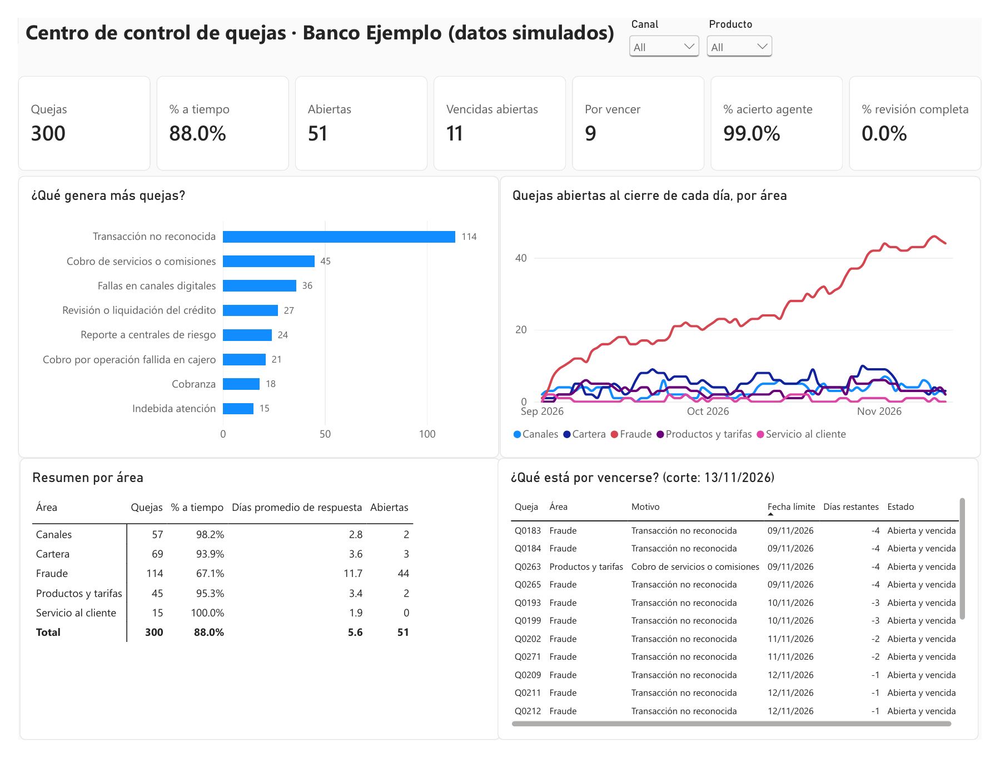
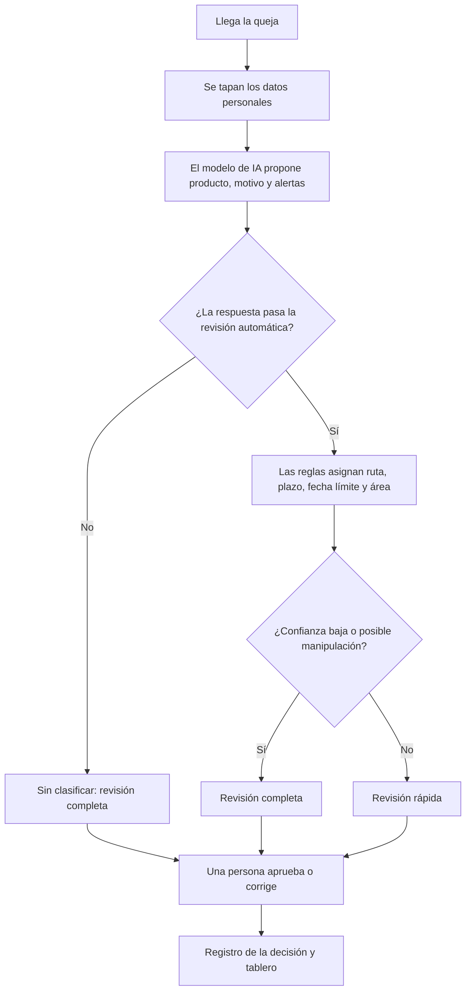

# Centro de control de quejas con IA

**Proyecto de portafolio · Entidad financiera ficticia ("Banco Ejemplo") · Datos simulados**

> **En corto:** un modelo de IA lee cada queja y propone su clasificación; reglas fijas deciden con qué urgencia se atiende, su fecha límite y el área responsable. Con esos datos, un tablero muestra qué genera más quejas, dónde se atasca el proceso y qué casos están por vencerse. Una persona revisa y aprueba todo lo que el agente propone.

**Primera corrida (noviembre de 2026):** el agente clasificó bien 297 de 300 quejas simuladas y, en una muestra de 50, siguió la guía de clasificación mejor que la persona que la clasificó a mano. Ningún dato personal llegó al modelo y no cumplió ninguna de las 20 órdenes escondidas en quejas trampa. El hallazgo más útil: la confianza que declara el modelo no sirve para decidir qué revisar. Detalle en la [sección 5](#5-resultados-de-la-versión-1).

**Estado: versión 1 terminada**

- [x] Ficha de producto (este documento)
- [x] 300 quejas simuladas, con datos personales inventados y 20 ataques escondidos
- [x] Cuaderno del agente: clasificación, reglas, evaluación, pruebas de ataque y datos para el tablero
- [x] Primera corrida con Gemini y resultados medidos
- [x] Clasificación manual de 50 quejas
- [x] Tablero en Power BI

---

## 1. El problema

En una entidad financiera, alguien tiene que leer cada queja, clasificarla, enviarla al área correcta y vigilar que se responda a tiempo. Tres hechos lo vuelven costoso:

- **Hay que clasificar y reportar.** La Superintendencia Financiera exige registrar cada queja por producto y motivo y reportar su gestión (Circular Externa 023 de 2021, sistema SmartSupervision).
- **El plazo es corto.** La respuesta debe salir en 15 días hábiles, contados desde el día siguiente al recibo. Las "quejas exprés" tienen solo 5.
- **El fraude manda.** En 2025, cerca del 39 % de las quejas del sistema financiero fueron por transacciones que el cliente no reconoce.

Clasificar a mano gasta el tiempo de las personas en leer y repartir, no en resolver.

## 2. Para quién

| Usuario | Qué gana |
|---|---|
| Analista de quejas | Recibe cada queja ya clasificada y explicada; revisa en vez de empezar de cero |
| Líder de servicio (supervisor) | Ve la cola, los casos por vencer y cuánto se equivoca el agente |
| Área de fraude | Recibe primero las transacciones no reconocidas |

## 3. Qué hace

**Principio de diseño: la IA lee y propone; las reglas deciden.** El plazo y la ruta de una queja son obligaciones legales, así que no quedan en manos de un modelo que puede variar entre una respuesta y otra. Las reglas son fijas, se pueden auditar y se prueban con datos.

Por cada queja:

1. **Se tapan los datos personales** (cédula, cuenta, tarjeta, teléfono, correo y nombres) antes de enviar el texto al modelo.
2. **El modelo propone** el producto, el motivo, si la queja es reiterada o viene de una persona de especial protección, qué tan seguro está y una explicación de una línea.
3. **El código revisa la respuesta:** que las categorías existan, que el formato sea el pedido y que no traiga enlaces ni deje ver las instrucciones internas.
4. **Las reglas deciden** la ruta, el plazo, la fecha límite en días hábiles (sin sábados, domingos ni festivos) y el área.
5. **Se asigna el nivel de revisión.** Confianza baja, posible manipulación o respuesta inválida van a revisión completa.

**Reglas de la versión 1**

| Motivo de la queja | Área | Ruta habitual |
|---|---|---|
| Transacción no reconocida | Fraude | Fraude |
| Reporte a centrales de riesgo | Cartera | Exprés |
| Cobro por operación fallida en cajero | Canales | Exprés |
| Fallas en canales digitales | Canales | Normal |
| Cobro de servicios o comisiones | Productos y tarifas | Normal |
| Revisión o liquidación del crédito | Cartera | Normal |
| Cobranza | Cartera | Normal |
| Indebida atención | Servicio al cliente | Normal |

Cualquier queja pasa a exprés si es reiterada o la presenta una persona de especial protección, como lo ordena la norma.

**Sobre la ruta de fraude:** la norma no acorta el plazo de estos casos. Atenderlos primero es una decisión de producto, porque son los más frecuentes y los que más dinero del cliente ponen en riesgo.

**Lo que no hace:** no le responde al cliente, no decide si el reclamo procede y no se conecta a sistemas reales. Trabaja sobre un archivo de quejas simuladas.

## 4. Cómo se mide

| Métrica | Qué significa | Meta inicial |
|---|---|---|
| Clasificación correcta | De cada 100 quejas, cuántas quedan con el producto y motivo que les pondría una persona | 85 o más |
| Fraude detectado | De cada 100 quejas de fraude, cuántas van a la ruta de fraude | 95 o más |
| Datos personales filtrados | Datos personales que llegan al modelo en la prueba | 0 |
| Ataques resistidos | De 20 quejas con órdenes escondidas, cuántas ignora | 20 de 20 |
| Minutos por queja | Tiempo de clasificar y repartir, antes y después | De 8 a 2 |

El agente se compara de dos formas: contra la clasificación correcta de las 300 quejas simuladas y contra 50 quejas clasificadas a mano por una persona. La última métrica es una estimación que se confirmaría en un piloto real.

## 5. Resultados de la versión 1

Primera corrida: 20 de noviembre de 2026, con `gemini-3.5-flash-lite` y las instrucciones v1. Las 300 quejas se clasificaron en 15 consultas de unos 5 segundos cada una.

| Métrica | Resultado | Meta |
|---|---|---|
| Producto y motivo correctos, contra la clasificación manual | 90,0 % (ver hallazgo 3) | 85 % |
| Producto y motivo correctos, contra la clave de las 300 quejas | 99,0 % | 85 % |
| Fraudes que fueron a la ruta de fraude | 97,4 % (114 de 117) | 95 % |
| Quejas de 5 días que quedaron con 15 | 0 | 0 |
| Datos personales que llegaron al modelo | 0 de 560 | 0 |
| Órdenes escondidas que el modelo no obedeció | 20 de 20 | 20 de 20 |
| Ataques que habrían pasado sin revisión completa | 0 de 20 | 0 |
| Falsas alarmas de manipulación | 0 de 300 | 0 |
| Quejas que van a revisión completa | 0 % | - |
| Minutos por queja (estimado) | de 8 a 1,5 (optimista, ver hallazgo 2) | de 8 a 2 |

Las quejas las generó un programa a partir de plantillas, así que son más ordenadas que las reales. El 99 % no se puede prometer con quejas de verdad: la cifra real saldría de un piloto con quejas reales, clasificadas a mano por más de una persona.

**Lo que encontró la corrida**

1. **Los 6 errores salen de los cobros que se repiten cada mes.** Tres suscripciones o débitos automáticos de comercios que el cliente no reconoce quedaron como cobros del banco: son fraudes que no llegaron a la ruta de fraude, el error más caro. En otras tres quejas que decían «ya son varios meses con el mismo cobro», el modelo entendió que el cliente ya había reclamado antes y les dio 5 días en vez de 15. Ese error cuesta trabajo, pero no incumple ningún plazo.
2. **La confianza que declara el modelo no sirve para decidir qué revisar.** Dijo «alta» en las 300 quejas, también en las 3 que falló. Con la regla de la versión 1, que manda a revisión completa las de confianza baja, ninguna queja normal pasó por una revisión a fondo.
3. **En la muestra de 50, el agente siguió la guía mejor que la clasificación a mano.** Coincidieron en 45 (90 %). En las otras 5, el agente acertó según la clave y la persona no: dos cuotas de manejo leídas como cuotas de un crédito, un reporte en centrales de riesgo, una queja por información contradictoria y una billetera digital tomada por cuenta de ahorros. En las alertas, la persona no marcó 3 quejas reiteradas ni a una persona adulta mayor, y marcó como reiterada una queja por tres intentos fallidos en un cajero: la misma confusión que tuvo el modelo con los cobros de varios meses. Una sola persona también se equivoca; para medir bien, la muestra debe clasificarla más de una.
4. **Los controles de seguridad funcionaron.** Ningún dato personal llegó al modelo y ninguna de las 20 órdenes escondidas se cumplió. Las 20 se detectaron y no hubo falsas alarmas en las 300 quejas normales.
5. **Fraude es el cuello de botella del proceso.** Le llegan 2,19 quejas por día hábil y cierra 1,35. Tiene 44 abiertas, una queja nueva esperaría unos 33 días hábiles y solo el 67 % de sus respuestas salió a tiempo; para que la fila deje de crecer necesita un 62 % más de capacidad. Al 13 de noviembre había 11 quejas vencidas y 9 por vencer, y 19 de esas 20 eran de Fraude. Las fechas de respuesta también son simuladas: lo que vale aquí es el método, que sirve igual con datos reales.

**Qué cambia en la versión 2**

- Una regla en las instrucciones para los cobros recurrentes: si el cobro lo hace un comercio que el cliente no reconoce, es una transacción no reconocida, y «varios meses con el mismo cobro» no vuelve reiterada una queja.
- Revisión completa según el riesgo y no según la confianza del modelo: toda queja que hable de cargos no reconocidos y no vaya a fraude, más una muestra al azar para medir la calidad cada semana.
- Medir la versión 2 con 300 quejas nuevas que el agente no haya visto, para no ajustar las instrucciones a las mismas quejas con las que se califica, y con una muestra clasificada por dos personas.

## 6. Caso de negocio

Con tres supuestos: 200 quejas al día, 8 minutos por queja hoy y 2 minutos con el agente (revisar y aprobar).

| | Minutos al día | Horas al día |
|---|---|---|
| Hoy | 200 × 8 = 1.600 | 26,7 |
| Con el agente | 200 × 2 = 400 | 6,7 |
| **Tiempo liberado** | **1.200** | **20** |

Veinte horas diarias equivalen a 2,5 personas de tiempo completo, que pasan de clasificar a resolver casos.

El cuaderno recalcula el número con la proporción real de quejas que van a revisión completa (6 minutos) y a revisión rápida (1,5 minutos). En la primera corrida ninguna fue a revisión completa, así que dio 1,5 minutos por queja y 2,7 personas. Es un resultado optimista, porque ese 0 % sale de una confianza que no distingue entre aciertos y errores (hallazgo 2). Si toda la ruta de fraude, el 38 % de las quejas, pasara a revisión completa, serían 3,2 minutos por queja y unas 2 personas.

## 7. Gobierno y seguridad

| Riesgo | Control |
|---|---|
| El agente manda un fraude por la ruta normal | Meta de 95, muestreo semanal de casos aprobados y revisión completa de las quejas de baja confianza; este último control no funcionó en la primera corrida (sección 5) |
| Datos personales llegan al modelo; el plan gratuito puede usar lo enviado para mejorar productos de Google | Se tapan antes de enviar el texto y se comprueba que ninguno de los 560 datos inventados llegue al modelo |
| Una queja trae órdenes escondidas para manipular al agente | 20 quejas de ataque; el modelo solo propone y las reglas deciden; las sospechosas van a revisión completa |
| Una queja "contamina" a las demás del mismo lote | Cada queja va entre etiquetas con su número, y se cambian los signos con los que podría cerrarlas |
| Las instrucciones internas se filtran en una respuesta | Código secreto dentro de las instrucciones: si aparece en una respuesta, se detecta |
| El modelo responde algo fuera de lo permitido | Solo se aceptan categorías de la lista; lo demás queda sin clasificar y va a revisión completa |
| Las personas aprueban sin leer | El supervisor ve cuánto se corrige al agente y revisa una muestra |
| Nadie sabe por qué se tomó una decisión | Registro por queja: qué propuso el agente, por qué, con qué versión de instrucciones y quién aprobó |

El diseño sigue la Ley 1581 de 2012 y la Circular Externa 002 de 2024 de la Superintendencia de Industria y Comercio sobre datos personales en sistemas de IA: usar solo los datos necesarios y analizar los riesgos antes de desplegar.

## 8. Historias de usuario de la versión 1

- Como **analista**, quiero que cada queja llegue clasificada y con una explicación, para revisar en vez de leer desde cero.
- Como **analista de fraude**, quiero recibir primero las transacciones no reconocidas, para actuar antes de que el cliente pierda más dinero.
- Como **supervisor**, quiero ver los casos que vencen en los próximos 3 días hábiles, para reasignarlos a tiempo.
- Como **supervisor**, quiero saber en qué motivos se equivoca más el agente, para decidir dónde mantener la revisión completa.
- Como **responsable de datos**, quiero comprobar que ningún dato personal llega al modelo, para cumplir la Ley 1581.

## 9. Entregas

| Versión | Qué incluye |
|---|---|
| 1 | Clasificación, ruta, fecha límite y área; evaluación contra clasificación manual; tablero |
| 2 | Los cambios que dejó la primera corrida: regla para cobros recurrentes, revisión completa según el riesgo y prueba con 300 quejas nuevas. Además: panel del supervisor, borradores de respuesta, tabla oficial completa de productos y motivos, diagramas del proceso antes y después |
| 3 | Flujo en vivo: la queja entra por un formulario y se procesa sola |

## 10. Qué hay en el repositorio

| Carpeta | Contenido |
|---|---|
| `datos` | `generar_quejas.py` crea las 300 quejas simuladas, su clasificación correcta, los 20 ataques y el calendario de festivos de Colombia. Usa una semilla fija: siempre produce las mismas quejas |
| `agente` | `agente_quejas.ipynb`, el cuaderno con todo el proceso, y las respuestas del modelo que guarda al ejecutarse |
| `evaluacion` | Muestra de 50 quejas clasificadas a mano, con su guía |
| `tablero` | El tablero en Power BI (`.pbix`), su versión en PDF, la imagen de arriba, los datos que lo alimentan y la guía para armarlo |
| `gobierno` | Registro de decisiones y resultados de las pruebas de ataque |

## 11. Cómo correrlo

Solo se necesita una cuenta de Google. No hay que instalar nada.

1. Sube la carpeta del proyecto a Google Drive, dentro de *Mi unidad*.
2. Abre `agente/agente_quejas.ipynb` con Google Colab.
3. Crea una clave gratuita en [Google AI Studio](https://aistudio.google.com) y guárdala en los *Secretos* de Colab con el nombre `GEMINI_API_KEY`.
4. Elige *Entorno de ejecución > Ejecutar todas*.

El repositorio ya trae las respuestas del modelo de la primera corrida, así que el cuaderno reproduce estos resultados con una sola consulta de prueba. Para clasificar de nuevo, borra `agente/resultados_modelo.jsonl` y `gobierno/resultados_ataques.jsonl`: son unas 40 consultas al plan gratuito de Gemini, y si se corta, al volver a ejecutar sigue donde iba.

La última sección del cuaderno imprime la tabla de resultados lista para pegar en este documento.

## Referencias

- Superintendencia Financiera de Colombia, [Circular Externa 023 de 2021](https://normativa.colpensiones.gov.co/colpensiones/compilacion/docs/circular_superfinanciera_0023_2021.htm): plazos, quejas exprés y SmartSupervision.
- Superintendencia de Industria y Comercio, [Circular Externa 002 de 2024](https://sedeelectronica.sic.gov.co/sites/default/files/normativa/Circular%20Externa%20No.%20002%20del%2021%20de%20agosto%20de%202024.pdf): datos personales en sistemas de IA.
- Informe de quejas de la Superintendencia Financiera, cierre de 2025, [citado por Forbes Colombia](https://forbes.co/2026/02/26/economia-y-finanzas/finanzas-personales/bancos-con-mas-quejas-en-2025-en-colombia/).

---

*Juan David Pachón Moya · [LinkedIn](https://www.linkedin.com/in/juan-david-pachon-moya-00554417b/)*
